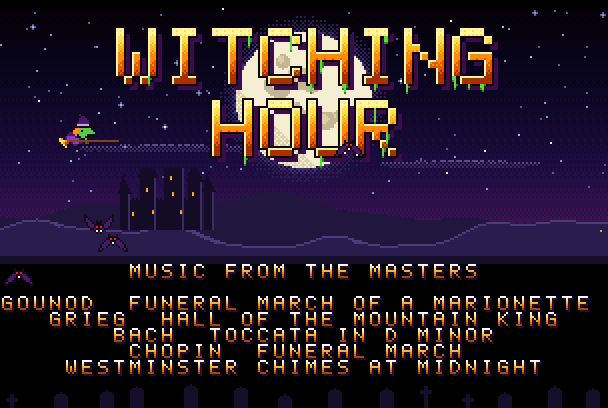
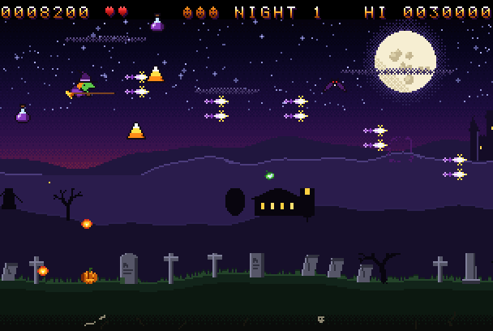
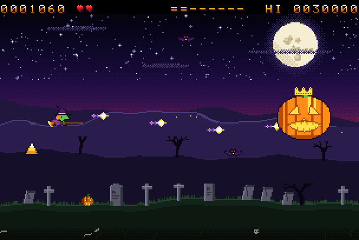
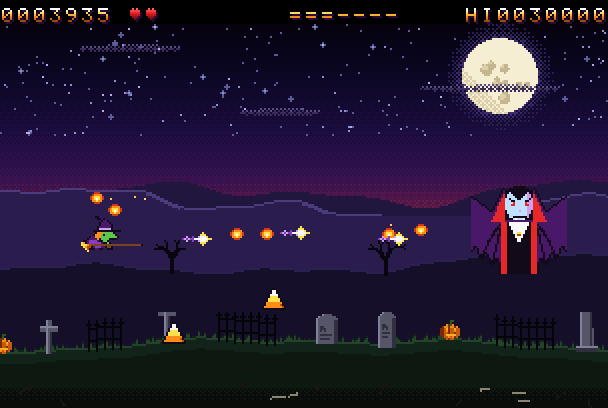

# Witching Hour

A Halloween shoot-'em-up for the MEGA65, written in C (and a little
assembly) with the [M65Compiler](../m65compiler) tool suite (cc45, ca45,
ln45, disk45, tune45).

The clock strikes twelve. A witch takes to her broom over the graveyard,
under a full moon, past the count's castle on its crag. Bats come in flocks.
Ghosts drift after her and fade in and out. Jack-o'-lanterns bounce along
the graves spitting fire. Flaming skulls stop, stare and then charge. At the
end of each night comes its master: the **Pumpkin King**, the **Bone
Lord** and the **Vampire Count** take their turns.






## The music

Every tune is a famous piece of spooky classical music, in the public
domain, arranged for the SID chips:

| When | Tune |
|---|---|
| Title | Gounod, *Funeral March of a Marionette* (the Alfred Hitchcock theme) |
| A night begins | The Westminster Quarters, then the bell strikes: midnight |
| The flight | Grieg, *In the Hall of the Mountain King*. As in Grieg, it gets faster and faster: its tempo follows the night's progress, and so does the scroll |
| The boss | Bach, *Toccata and Fugue in D minor*: the famous opening, then a driving toccata figure with pedal and timpani |
| The Vampire Count | The *Dies irae*, the medieval chant of the Day of Wrath, as Berlioz set it in the witches' sabbath of his *Symphonie fantastique*: bells toll, the brass intone it, then it goes faster and into a dance |
| A night won | A fanfare on the chime's notes |
| Game over | Chopin, *Funeral March* (Piano Sonata No. 2) |

Sound effects run on the second SID (spell zaps, crunches, screeches, a
skull's charge). Three synthesised samples play on the audio DMA: the
witch's cackle, thunder (lightning flashes across the sky now and then)
and a big boom.

## Playing

| Key | Joystick (either port) | Action |
|---|---|---|
| Cursor keys or W A S D | stick | fly |
| SPACE or RETURN | fire | cast a spell (hold for a stream) |
| B or M | second button | the **midnight toll**: strikes everything on the screen (three a night) |
| P | | pause |
| RUN/STOP | | quit |

- **Candy corn** is 500 points, a **potion** widens the spell (up to three
  streams), a **black cat** is an extra life. There is another life every
  25,000 points.
- Being hit costs a life and a level of the spell.
- A faded ghost can't be hit: wait for it to come back.
- **Chains:** kill again within two seconds and the chain grows. At 4, 10,
  18 and 30 kills it multiplies every kill's points by 2, 3, 4 and 5 (shown
  as X2-X5 at the top). Being hit breaks it.
- The Pumpkin King and the Bone Lord fire fans and aimed volleys, and call
  their friends. The Vampire Count throws rings of blood, fires in pairs,
  and turns into a flock of bats, then reappears somewhere else.
- Leave the title alone and the witch flies a demo. A good score gets three
  initials in the hall of fame, which is saved on the disk (`WITCHHOF`) and
  loaded at the next start.

## Build and run

```sh
make            # build/witching.d81: WITCHING and its data WITCHGFX1-4
make run        # build it and boot it in xemu-xmega65
make demo       # the self-playing build, in xemu
make screenshot # the self-playing build, headless: build/screenshot.png
make preview    # the art as PNG pictures: build/preview_*.png
make play       # the music on this computer (tune45 play)
make clean
```

Variables: `M65=<path>` (the compiler tree, default `../m65compiler`),
`XEMU=<emulator>`, `SHOT_DELAY=<seconds>`. On a MEGA65, copy
`build/witching.d81` to the SD card, mount it and `RUN "WITCHING"`.

## How it works

**The art** (`tools/gen_art.py`, `tools/sprites.py`) is all drawn by
program: the dithered night sky, the moon and its halo, the stars, the far
mountains with the castle and its lit windows, the near hills with dead
trees, a church and a windmill, and a graveyard of headstones, crosses,
obelisks, iron fences, jack-o'-lanterns and bones in the soil. The pictures
are cut into 8 x 8 full-colour characters (each different one kept once,
about 1,600 of them). The sprites and the font are drawn as text. The
palette is animated: stars twinkle, windows and lanterns flicker.

**The display** (`src/video.c`) is the VIC-IV at 320 x 200 with 16-bit
characters. Each row is read through the raster-rewrite buffer (RRB):
- a GOTOX cell first, which is the row's fine scroll, so the far hills,
  near hills and graveyard scroll at their own speeds (parallax);
- then the 41 background cells, copied from the band's map by DMA;
- then 11 object slots. Each slot is a transparent GOTOX to the object's X,
  with a character data Y offset, and two characters. An object is a strip
  of characters, and the Y offset shows it from any pixel row, so enemies,
  bullets and pickups move pixel by pixel in both directions over the
  background.

Nothing changes while the screen is drawn: it is all screen RAM (in bank
0 at $C000) written in the vertical blank. The witch and the bosses are
16-colour hardware sprites.

**The music** is tune45 text (`assets/music.txt`), converted to one blob
(`WITCHGFX4`) that is loaded into bank 1 and played from there
(`tune_play_far`) by the library's tune player, from a raster interrupt in
the bottom border.

## Files

| | |
|---|---|
| `src/main.c` | the title, its pages, the hall of fame, the demo |
| `src/game.c` | the game: the witch, enemies, waves, bosses, pickups |
| `src/video.c` | the display: bands, RRB objects, sprites, palettes |
| `src/sfx.c` | sound effects and samples |
| `src/load.s45` | loading the data from disk; the audio DMA; the interrupt's entry |
| `tools/screenshot.py` | headless xemu screenshots (`PEEK=` prints memory too) |
| `tools/gen_art.py` | all the graphics; `sprites.py` the sprites; `sounds.py` the samples |
| `assets/music.txt` | the music |
